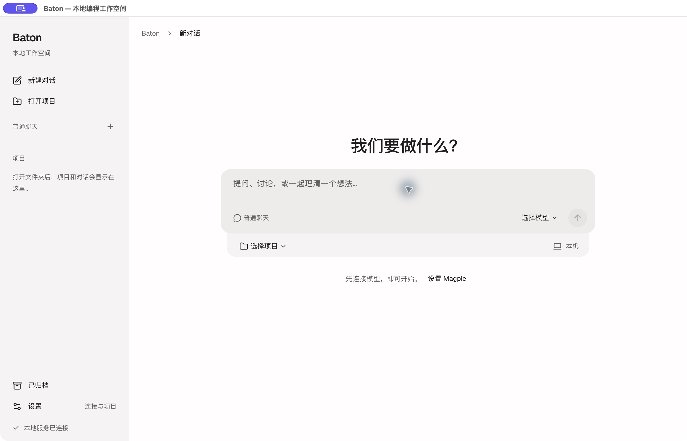

# Baton

一个支持普通聊天的本地桌面编程助手。在同一段对话里理解代码、修改文件、运行测试，并查看每一步工具操作和文件改动。

Baton 使用 **Pi 1.4.0** 执行 Agent 循环和保存会话，所有模型请求只经过你独立运行的 **Magpie**。Baton 不管理供应商账号，也不会读取 Codex、Cursor 或其他应用的登录文件。



## 开始使用

1. 独立启动 Magpie，并在 Magpie 中配置模型服务。
2. 启动 Baton，进入 **设置 → 连接与模型**。填入 Magpie API 基础地址，例如 `http://127.0.0.1:3425/v1`。如网关要求鉴权，再填写网关凭据。
3. 保存连接后，Baton 自动读取并检测模型。在 **聊天框中的模型** 勾选常用模型，或使用 **全选／全不选**。检测通过不会自动加入聊天框；全不选不弹提示。首次检测每个新增模型会发送两次小型请求，结果会缓存，失败可重试。
4. 启动后直接在居中输入框聊天，默认不选择项目。需要操作文件时，在输入框下方选择项目；点击合并的模型与推理强度入口选择参数。发送第一条消息才会保存对话。
5. 项目对话默认权限为 **询问**。修改文件、运行命令或调用外部工具前，查看目标与预览，再允许或拒绝本次操作。

支持 Magpie 明确报告具有工具调用能力的 Chat Completions 和 Responses 模型。目录能连接不等于工具链可用；未知能力不会根据模型名称补全。

## 日常工作

- **草稿与归档**：重复点击新建复用同一个草稿，不生成空历史；切换会话或设置保留本次打开期间的未发送输入。悬停侧栏对话可归档，底部“已归档”可搜索、恢复；历史和项目文件保留，运行中的对话需先停止。
- **普通聊天**：不选择项目也能问答、讨论和解释粘贴的代码。历史独立保存，支持换模型与重启续聊；不开放本机文件、命令或项目资源。
- **模型与推理强度**：使用同一个入口，紧凑面板上的白点对应模型实际支持的档位，可拖动或使用方向键选择。只在 Magpie 明确报告支持快速模式时显示闪电；点击面板内闪电可开关，默认关闭，开启后可能增加用量。更换模型会回到普通模式。模型目录在空闲时每分钟自动同步，也可在设置中手动刷新。聊天框只展示你勾选且可用的模型，检测状态仅在设置页显示。
- **持续对话**：每个对话对应持久化 Pi 会话。切换模型或重启 Baton 后继续使用已有历史；可在输入框下方“上下文”菜单中手动压缩。完整记录保留，但摘要可能省略细节。
- **运行中补充**：选择“影响当前任务”或“完成后再处理”。投递时机遵循 Pi，不保证立即打断已经启动的命令。“停止”不会自动撤销文件。
- **项目组织**：每个项目可以有多个对话，点击项目前的箭头折叠或展开，重开后保留偏好。不同项目并行，同项目任务按顺序运行；移除侧栏入口保留项目文件和历史。
- **文件改动**：查看某次运行的前后内容，预览后再撤销。恢复保留运行前已有的未提交修改；发现后续编辑或无法确定改动归属时拒绝自动恢复。
- **明确的用量**：只展示上游实际返回的 token 数据。费用或上下文能力缺失时显示未知。

### 在 Magpie 中管理 Baton

仓库附带 [Baton Agent 插件](integrations/magpie)。在 Magpie 的插件页添加该目录，或运行：

```sh
magpie plugin add /absolute/path/to/baton/integrations/magpie
```

启动过一次 Baton 后，它会出现在 Magpie 的 Agent 列表，支持接入开关、默认模型选择和独立用量归属。连接写入单独的 `v2/magpie.json`；关闭接入后恢复 Baton 原来的手动连接。运行中的任务结束后才同步连接变更。

Magpie 默认模型只作用于新对话，并且仍需在 Baton 设置中勾选、检测可用；已有对话保持原模型。详细安装与自定义数据目录说明见[插件 README](integrations/magpie/README.md)。

### 三种权限

| 权限 | 行为 |
| --- | --- |
| 只读 | 仅开放项目读取工具，不开放命令、写入或外部工具 |
| 询问 | 每次写入、命令或外部工具调用都需单独批准，默认选择 |
| 直接执行 | 当前对话直接执行；不传播给其他对话，重启后恢复询问 |

这些是应用层工具权限。命令和受信扩展仍具有本机用户权限，不是操作系统安全隔离。批准的命令可能访问项目以外的文件或外部系统。

### 规则、Skills、扩展与记忆

首次发现的资源默认停用，在 **设置 → 规则与 Skills** 中确认来源后启用。按列表顺序加载规则，变更在下一次运行生效。

```text
项目/
├── AGENTS.md
└── .baton-v2/
    ├── rules/*.md
    ├── skills/<name>/SKILL.md
    ├── extensions/<name>.mjs
    └── memory/*.md
```

Baton 也支持自身数据目录中的 `v2/resources/{rules,skills,extensions}` 和手动添加的路径，不自动扫描其他 Agent 应用的配置。

扩展须附带 `<扩展文件>.baton.json`：

```json
{ "host": "baton-v2", "ui": "none" }
```

声明用于限制兼容范围，不代表安全认证。首版只适配无需终端 UI 的选定扩展，代码变化后需要重新确认。加载失败会显示错误。

项目记忆是明确保存的 Markdown 文件，Agent 按需读取，不后台自动提炼，不默认跨项目共享。可在设置中查看、编辑、删除；保存与删除遵循所选对话权限。历史消息中的旧副本仍然保留。

### MCP 工具

在 **设置 → MCP 工具** 中填写已安装服务的配置并检查连接。例如：

```json
[
  {
    "name": "local-tools",
    "command": "node",
    "args": ["/absolute/path/to/server.mjs"],
    "enabled": true
  }
]
```

也可使用 `{ "name": "service", "url": "https://example.com/mcp", "enabled": true }` 配置 HTTP 服务。首版未适配 MCP OAuth 登录。

启用服务代表信任其进程；工具仍受对话权限控制，自报只读不能免除审批。连接失败不会阻断不依赖该服务的普通对话。连接与工具状态显示在当前对话记录中。

## 本地开发

需要 Node.js **22.19 或更新版本**、pnpm **10.33.4**。桌面工具运行项目命令时，还需要本机安装相应语言环境。

```bash
corepack enable
corepack prepare pnpm@10.33.4 --activate
pnpm install --frozen-lockfile
pnpm dev
```

开发前端为 `http://127.0.0.1:47320`，本地应用服务为 `http://127.0.0.1:47321`。开发服务和桌面应用默认使用同一端口，启动桌面前先停止开发服务。

```bash
pnpm typecheck
pnpm test
pnpm build
pnpm smoke:start
pnpm smoke:dev
```

生产网页仅用于开发调试：`pnpm build && pnpm start`。

### 构建桌面包

```bash
pnpm desktop
```

产物位于 `apps/desktop/out/`。macOS 打开目录中的 `Baton.app`；Windows 解压完整目录后运行 `Baton.exe`，保留旁边的资源文件。

可指定目标平台和架构：

```bash
pnpm build
pnpm --filter @baton/desktop build -- --platform=win32 --arch=x64
```

CI 包含 macOS、Windows 与 Linux 检查，以及 macOS / Windows 桌面打包。打包成功不能替代相应操作系统的真实桌面验收。首版未提供正式签名、公证或自动更新。

**已验证环境：macOS arm64。Windows x64 包保留待验收**，当前没有 Windows 真实桌面环境；用户已明确接受保留该待办。逐项状态和证据见 [spec](docs/spec.md#8-当前工程状态与验证证据)。

## 数据与恢复边界

默认数据位于 `~/.baton/v2`；设置 `BATON_HOME` 可改变根目录，新版始终在其下使用 `v2` 命名空间。

| 内容 | 位置 |
| --- | --- |
| 项目、对话和运行投影 | `v2/state.json` |
| Pi 完整会话 | `v2/sessions/<thread>/` |
| 运行前后文件快照 | `v2/changes/<project>/` |
| 手动网关连接、检测缓存与聊天框名单 | `v2/gateway.json` |
| Magpie 管理的独立接入配置 | `v2/magpie.json` |
| 桌面日志 | `v2/desktop.log` |
| 项目记忆 | 项目内 `.baton-v2/memory/*.md` |

网关凭据只保存为本机受限文件，不进入界面响应或模型上下文。模型上下文会通过 Magpie 发往你选择的服务，外部工具也可能访问外部系统。Baton 不新增遥测。

旧版数据不会自动迁移或删除。可以通过 **导入 Markdown** 预览并选择性导入旧规则或记忆，目标冲突需再次确认。旧供应商凭据不会被读取，清理由你自行决定。

文件快照排除 `.git`、旧 `.baton`、`node_modules`；单文件最多 16 MB、总内容最多 256 MB、最多 30,000 个条目。超限、特殊文件或无法可靠扫描时阻止可写运行。符号链接不跟随，硬链接拒绝建立可恢复基线。

自动恢复适用于能够可靠归属的文件工具写入。命令、扩展或 MCP 改变项目文件时保留 diff，但因归属不确定而阻止自动恢复。数据库、网络请求、安装依赖造成的环境变化等外部副作用不能通过文件恢复撤销。

关闭窗口会退出 Baton、取消自身任务并保存状态，独立 Magpie 继续运行。异常退出后的任务标记为中断，不自动重放命令；会话文件缺失时停止继续运行，避免静默丢失历史。

## 工程结构

```text
apps/desktop   Electron 桌面入口、文件夹选择与打包
apps/web       React 对话、审批、设置与改动查看
apps/server    本机 API、项目队列、审批、运行状态
packages/core  Pi 适配、唯一网关出口、资源、快照与命令执行
integrations/magpie  Magpie Agent 插件
```

[产品规格与验收状态](docs/spec.md)是唯一需求状态来源；[实现设计](docs/design.md)描述架构与取舍。旧版供应商登录、ACP、独立检查会话、角色编排、接力流程及 MCP 服务端入口已从当前代码移除，历史通过 Git 查阅。
